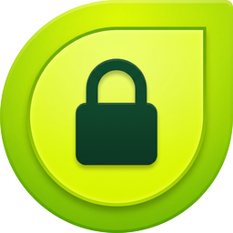

<p align="center"></p>

# KeePass Keyboard for Sailfish OS

**KeePass Keyboard** (`keepass-kbd`) is a keyboard layout for Sailfish OS that fills logins from your
KeePass database (`.kdbx`) into **any app** — native Sailfish apps, the browser and Android (AppSupport)
apps — without copying passwords through the clipboard. It can also **generate** strong passwords and
**save** new entries back into the database.

It works directly on your `.kdbx` file (for example a file synced with Nextcloud, Syncthing or rclone):
no import, no second vault, and changes made elsewhere (KeePassXC, KeePassDX…) are picked up automatically.

## Features

- **Fill logins in one tap** — tap an entry: the username is typed, the keyboard moves to the next field and types the password. Separate *Username* / *Password* buttons are also available.
- **Suggestions** for the current website or app (matched on URL, secondary URLs `KP2A_URL`, `KP2A_URL_1`…, domain, Android package or entry title).
- **Search** across title, username, URLs (secondary ones included) and folder, most recently used first.
- **Password generator** (8–64 characters, lowercase / uppercase / digits / symbols), then **save** the new login: title and username are pre-filled from the current app or page, and the entry goes to a configurable folder (`keepass-kbd` by default).
- **Safe writes** — before writing, the database is re-read and fully verified, a local backup is made, concurrent changes are detected and the file is replaced atomically. A system notification confirms the result.
- **One-time codes (TOTP)**, optional — a *Code* button types the current two-factor code of the entry (`otp` field of KeePassXC / KeePassDX, `TimeOtp-*` fields of KeePass 2, legacy `TOTP Seed`; SHA-1/256/512, Steam). Off by default; the secret key never leaves the service.
- **Add a two-factor code** to an entry, from the keyboard or the settings: type or paste the secret key or the `otpauth://` link, pick a screenshot of the site's QR code, or scan it with the camera (settings). The current code is shown so you can finish the activation on the site; it is saved in the entry's `otp` field (KeePassXC / KeePassDX format), the previous version going to the entry history.
- **Separate database for one-time codes**, optional — keep the codes in another `.kdbx` protected by its own password, password and key file, or key file only, so that the master password alone does not give the second factor. The database (and its key file) can be created from the settings. Codes are matched to password entries by a link set when the code is added (`KeePassKbd-Link` field), otherwise by website and username, then by title and username.
- **Key files** — the password database can also be protected by a key file; new key files use the KeePass 2 XML 2.0 format (KeePassXC, KeePassDX).
- **Automatic reload** when the `.kdbx` file changes on disk.
- **Lock policy** — ask for the master password again on every restart, every 24 h / 1 h / 30 min / 5 min, or on every wake-up.
- The master password is typed on the layout's **own mini keyboard**: it is never sent to the app in the foreground.
- **Settings page** in *Settings › Text input*: database file, lock policy, folder for new entries, about, uninstall.
- **Localised**: English (default), French, German, Spanish, Italian, Finnish, Swedish, Dutch, Russian — following the phone language. The mini keyboard follows the language too (QWERTY / AZERTY / QWERTZ and accents).

## Requirements

- Sailfish OS 5.x, **aarch64** (tested on Sailfish OS 5.2 / Jolla Phone).
- The stock Jolla keyboard (installed by default).
- **[FUTO Keyboard for Sailfish](https://github.com/solboki/futo-keyboard-sailfish) — optional but recommended.**
  KeePass Keyboard works on its own (filling, search, generator, saving, settings, suggestions for native apps).
  With FUTO installed you also get **suggestions for websites and Android apps**, and the **username typed on the page** is reliably reused when saving a new login.
- A KeePass database in **KDBX 4** format (KeePassXC, KeePassDX, KeePass 2…). KDBX 3 files can be read but not written.

## Installation

1. Download `keepass-kbd-<version>-1.aarch64.rpm` from the [Releases](https://github.com/solboki/keepass-kbd/releases) page.
2. Install it, either by opening the file from the *Downloads* / *File browser* (allow untrusted software in *Settings › Untrusted software*), or in a terminal:
   ```sh
   devel-su pkcon install-local keepass-kbd-*.aarch64.rpm
   ```
3. The **KeePass** layout is enabled automatically next to your keyboards. Open *Settings › Text input › KeePass Keyboard* (or tap the gear icon in the layout) and **choose your `.kdbx` file**.

## Usage

- Switch to the **KeePass** layout like any other keyboard (long-press or swipe on the space bar, depending on your keyboard).
- Type your master password on the mini keyboard, then ✓. Tap the eye to show it; tap anywhere in the text to move the cursor.
- **Fill a login**: tap the entry (suggested entries are starred). Use *Username* / *Password* if the app needs it, and ⌫ to erase in the app's field.
- **Two-factor code**: once *One-time codes (TOTP)* is enabled in the settings, entries with a TOTP show a *Code (N s)* button next to *Password*; it is highlighted when the app's field is numeric. Code fields show the Jolla number or phone pad, where swiping between layouts is not possible: tap the **KeePass key** at the bottom left of the pad to open the KeePass layout; once the code is typed, the pad comes back. (The package adds this key to the `jolla-keyboard` pad files and puts it back at boot after a Sailfish OS update; uninstalling restores the original files.)
- **Add a two-factor code**: when a site shows its QR code, take a screenshot. Choose the entry, tap **+ Code** (third button, shown for entries without a code), then *Screenshot* and pick the image — or *Paste* / type the secret key. Check the code shown, type it on the site with *Type the code* if asked, then *Save*. In the settings, *Add a one-time code to an entry* does the same and can also scan a QR code shown on another screen with the camera; it can also replace an existing code.
- **Separate codes database**: in the settings, section *One-time codes database (OTP)* › *Create a new database…* (or *Choose another file…*). When it is locked, the third button shows *Code* with a lock: tap it and type the codes database password (nothing to type with *Key file only*). The lock policy applies to both databases.
- **New password**: tap **+**, adjust length and character types, tap **Use**: the password is typed into the field and the save page opens. Check title, username and URL, then *Save to KeePass*.
- Tap the keyboard icon (top left) to go back to your previous keyboard. Closing the keyboard also returns to it.

## Security

- The service only answers the keyboard process (`/usr/bin/maliit-server`); the Settings app may change settings and lock, and for one-time codes list entry titles and usernames and add a code — it never reads passwords or keys.
- Camera scans are written to the session's runtime folder (in memory) and deleted as soon as they are read. Screenshots of QR codes stay in your gallery: delete them once the code is saved.
- The service's D-Bus name is exclusive and cannot be taken over by another process.
- Secrets are kept in memory only while the database is unlocked and are zeroised when no longer needed; nothing is written to disk except the database itself and its backups (`~/.local/share/keepass-kbd/backups`).
- Writes are refused if rewriting the database would lose anything the library does not understand (two harmless differences are tolerated: the obsolete KDBX 3 `HeaderHash` and an explicit default `QualityCheck`).
- Uninstalling from the settings page uses a polkit rule limited to removing this package.

## Configuration

`~/.config/keepass-kbd/config.json` (edited from the settings page):

| Key | Default | Meaning |
|---|---|---|
| `database` | — | Path of the `.kdbx` file |
| `keyfile` | `null` | Optional key file |
| `relock_policy` | `30min` | `restart`, `24h`, `1h`, `30min`, `5min` or `wake` |
| `new_entry_group` | `keepass-kbd` | Folder for new entries (`Internet/Apps` for nested folders, empty for the root) |
| `poll_seconds` | `15` | How often the file is checked for changes |
| `backups_keep` | `20` | Number of local backups kept |
| `totp_enabled` | `false` | Show the *Code* button for entries with a one-time code |

## Uninstall

*Settings › Text input › KeePass Keyboard › Uninstall KeePass Keyboard*, optionally deleting settings and local backups.
Or in a terminal: `devel-su pkcon remove keepass-kbd`. Your `.kdbx` database is never modified.

## Building from source

On the phone (or a Sailfish SDK aarch64 target) with Rust and [`cargo-generate-rpm`](https://github.com/cat-in-136/cargo-generate-rpm):

```sh
cargo install cargo-generate-rpm
scripts/build-rpm.sh          # → target/generate-rpm/keepass-kbd-<version>-1.aarch64.rpm
cargo test                    # unit tests
```

Project layout:

| Path | Content |
|---|---|
| `src/` | Rust service: D-Bus API, KDBX read/verified write, generator, suggestions, translations of service messages |
| `qml/` | Maliit keyboard layout (`keepass.qml`), components and UI translations (`KpxStrings.js`) |
| `settings/` | Settings pages and *Text input* entry |
| `dist/` | systemd/D-Bus files, RPM scriptlets, polkit policy, uninstall scripts |
| `scripts/` | `build-rpm.sh`, `bump-version.sh`, `mkqm.py` (Qt `.qm` catalogs without `lrelease`) |

`install-layout.sh` and `install-user.sh` are kept for development installs without a package (do not mix with the RPM).
Versions follow [SemVer](https://semver.org); see [CHANGELOG.md](CHANGELOG.md).

## Translations

UI strings are in `qml/KpxStrings.js` (key = English text), service messages in `src/i18n.rs`.
Corrections and new languages are welcome — please open an issue or a pull request.

## Credits

- [keepass-rs](https://github.com/sseemayer/keepass-rs) — KDBX reading and writing (MIT)
- [zbus](https://github.com/dbus2/zbus) — D-Bus (MIT)
- [rqrr](https://github.com/WanzenBug/rqrr) — QR code reading (MIT / Apache-2.0); [image](https://github.com/image-rs/image) — PNG / JPEG decoding (MIT / Apache-2.0)
- rust-argon2, sha1, sha2, rand, zeroize, serde, chrono, uuid, blocking (MIT / Apache-2.0)
- Sailfish OS, Silica and Maliit — Jolla; Qt 5 — The Qt Company
- [FUTO Keyboard for Sailfish](https://github.com/solboki/futo-keyboard-sailfish) — current site and app detection
- KeePass format: the KeePass project by Dominik Reichl

Developed by **Boris Solodki** (solboki@solodki.fr).

## License

[GPL-3.0-or-later](LICENSE).
